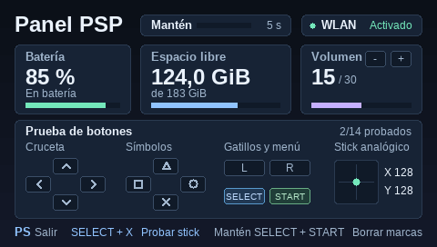
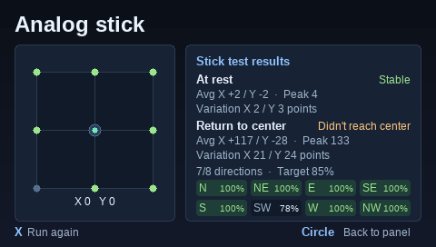

# Panel PSP

[English](README.md)

Panel de diagnóstico para PlayStation Portable. Consulta la batería, el espacio libre en la Memory Stick, el volumen y la posición del interruptor WLAN. Prueba también los botones y el stick analógico desde la propia consola.

[Descargar Panel PSP](https://github.com/JuanCarlosGP/panel-psp/releases/latest/download/Panel-PSP.zip)

| Panel principal | Prueba del stick |
| --- | --- |
|  |  |

## Instalación

Probado en una **PSP-3004 con firmware 6.61 y ARK-5.2.2**. La aplicación usa funciones de [ARK-5](https://github.com/PSP-Arkfive/ARK-5) para leer el volumen y sus botones.

1. Descarga y descomprime `Panel-PSP.zip`.
2. Copia la carpeta `PSP` del ZIP a la raíz de la Memory Stick. El ejecutable debe quedar en `PSP/GAME/PANELPSP/EBOOT.PBP`.
3. En la consola, abre **Juego → Memory Stick → Panel PSP**.

## Pruebas

El panel reconoce 14 botones, incluidos **+** y **−**. Una pulsación deja la marca azul. Mantén el botón 5 segundos seguidos para que quede verde. Si se interrumpe la pulsación, su contador vuelve a cero. Mantén **SELECT + START** para borrar las marcas.

Mantén **SELECT** y pulsa **X** para abrir la prueba del stick.

1. **Reposo.** Pulsa **X** y deja el stick quieto 5 segundos para medir su desvío y su oscilación.
2. **Vuelta al centro.** Empuja el stick al tope de un eje y suéltalo. El panel observa durante 2 segundos si vuelve al centro y se estabiliza. Si la cuenta no empieza al soltarlo, pulsa **X** con el stick ya suelto.
3. **Recorrido por el borde.** Pulsa **X** y da una vuelta lenta por el borde. La cuadrícula muestra el alcance de cada eje y marca los cuatro lados y las cuatro esquinas. Pulsa **X** para ver el resultado.

## Compilación

Instala [PSPDEV](https://github.com/pspdev/pspdev/releases/tag/v20261001). El proyecto enlaza con las bibliotecas de importación de [psp-cfw-sdk](https://github.com/pspdev/psp-cfw-sdk), incluidas en esa distribución de PSPDEV.

```sh
export PSPDEV=/ruta/a/pspdev
export PATH="$PSPDEV/bin:$PATH"
make
```

El resultado es `EBOOT.PBP`. El icono y la fuente de mapa de bits ya vienen incluidos. Para regenerarlos con `assets.py`, usa Python, Pillow y las fuentes Liberation Sans.

Los avisos de terceros están en [FONT-LICENSE.txt](FONT-LICENSE.txt) y [licenses/](licenses/).
