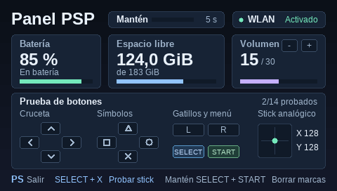
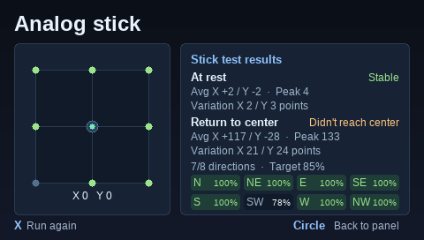

# Panel PSP

[Español](README.es.md)

A diagnostic app for the PlayStation Portable. Check the battery level, free space on the Memory Stick, system volume, and WLAN switch position. Test the buttons and analog stick directly on the console.

[Download Panel PSP](https://github.com/JuanCarlosGP/panel-psp/releases/latest/download/Panel-PSP.zip)

| Main panel | Analog stick test |
| --- | --- |
|  |  |

## Installation

Tested on a **PSP-3004 running firmware 6.61 with ARK-5.2.2**. The app uses [ARK-5](https://github.com/PSP-Arkfive/ARK-5) functions to read the volume level and detect presses on the volume buttons.

1. Download and extract `Panel-PSP.zip`.
2. Copy the `PSP` folder from the ZIP to the root of the Memory Stick. The executable should be at `PSP/GAME/PANELPSP/EBOOT.PBP`.
3. On the console, open **Game → Memory Stick → Panel PSP**.

## Testing the controls

Hold **SELECT** and press **□ (Square)** on the main panel to switch between English and Spanish. The app remembers your choice. The first time you open it, it uses Spanish if your PSP is set to Spanish and English for the other system languages.

The panel recognizes 14 buttons, including **+** and **−**. A quick press marks a button blue. Hold it down for 5 seconds straight to turn it green. Releasing it early resets its timer. To clear the marks, hold **SELECT** and press **○ (Circle)**.

Hold **SELECT** and press **X** to open the analog stick test.

1. **At rest.** Press **X** and leave the stick untouched for 5 seconds. The panel measures how far it sits from the center and how much it jitters.
2. **Return to center.** Push the stick all the way up, down, left, or right, then let go. The panel checks for 2 seconds whether the stick returns to center and settles. If the countdown doesn't start when you let go, press **X** with the stick released.
3. **Outer range.** Press **X** and slowly sweep the stick around the outer edge. The grid shows the range of each axis and marks all four sides and corners. Press **X** to see the results.

## Building from source

Install [PSPDEV](https://github.com/pspdev/pspdev/releases/tag/v20261001). The project links against the [psp-cfw-sdk](https://github.com/pspdev/psp-cfw-sdk) import libraries included in that PSPDEV release.

```sh
export PSPDEV=/path/to/pspdev
export PATH="$PSPDEV/bin:$PATH"
make
```

The build produces `EBOOT.PBP`. The icon and bitmap font are included. To regenerate them with `assets.py`, use Python, Pillow, and the Liberation Sans fonts.

Third-party notices are in [licenses/](licenses/), including the [Liberation Sans font license](licenses/FONT-LICENSE.txt).
